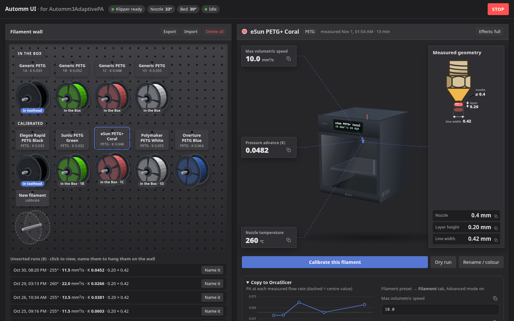

# automm-ui

**A friendly web interface for [Automm3AdaptivePA](https://github.com/Buddman69/Automm3AdaptivePA) on QIDI printers.**

> ### This is only a user interface
>
> automm-ui doesn't measure, calculate or calibrate anything itself.
> **All of the real work is [Automm3AdaptivePA](https://github.com/Buddman69/Automm3AdaptivePA) by
> [Buddman69](https://github.com/Buddman69)**: reading the toolhead load cell, finding the
> maximum volumetric flow, measuring pressure advance at several flow rates, building the
> OrcaSlicer table and all the safety checks around it. automm-ui sends his commands and shows
> his results in a nicer way, nothing more. You need his project installed for this one to do
> anything. See [Credits](#credits).

<!-- Screenshots: add images to docs/images/ and link them here, e.g.  -->

## What you get

- **A page inside Fluidd.** A **Calibration** entry in Fluidd's sidebar opens it full-size,
  right next to everything else you use. It also works on its own at `http://<printer-ip>/automm/`,
  and inside OrcaSlicer's Device tab.
- **A filament wall.** Your filaments hang on a pegboard as 3D spools, in their real colours.
  The spools in your QIDI Box show up automatically, tagged *in the Box* or *in toolhead*.
- **Calibrate with a form instead of console commands.** Pick a spool, check the temperature and
  nozzle size, tick the safety checklist and press start. A **Dry run** button shows the plan
  without heating anything.
- **Watch it live.** A step-by-step progress bar (max flow → flow points → pressure advance →
  Orca table → cool-down) and a colour-coded console, with a big **STOP** button.
- **Results you can use straight away.** Max volumetric speed, pressure advance, temperature and the
  geometry it was measured at, each with a **copy** button, plus a chart and the exact fields to
  paste into OrcaSlicer.
- **Your history, organised.** Name each run after the filament it was for, give it a colour and
  material, compare runs, and **export / import** the whole wall as a backup.
- **Fits in.** Uses Fluidd's own colours, works on phones, and has a *lite* mode (switched on
  automatically when the page runs slowly, like in OrcaSlicer).

## Requirements

| | |
|---|---|
| Printer | **QIDI Q2** (the only printer it has been tested on). Other printers that Automm3AdaptivePA supports, like the X-Max 4, may work but are untested. |
| Firmware | Whatever Automm3AdaptivePA needs. For the Q2 that's `01.01.02.04` or newer. |
| **Automm3AdaptivePA** | **Installed and working** - run at least one calibration with it first. → [Automm3AdaptivePA](https://github.com/Buddman69/Automm3AdaptivePA) |
| Web interface | **Fluidd** for the sidebar entry (tested with v1.30.5). Mainsail should show the page at `/automm/`, but has no sidebar entry and is untested. |
| Your computer | Any OS with SSH: Linux, macOS, or Windows 10/11. |

## Install

The installer runs on the printer, needs **no sudo** and never touches Klipper, `printer.cfg` or
Automm3AdaptivePA. Everything it does is undone by `--uninstall`.

> **QIDI Q2 owners:** log in as **`qidi`** (default password `qiditech`), **not `mks`**.
> Klipper, Moonraker and Fluidd belong to `qidi`; `mks` can't write to them.

### Option A: from your computer (easiest)

1. Download this repository (green **Code** button → **Download ZIP**) and unzip it.
2. Open a terminal in the unzipped folder and run:

   ```bash
   ./install-from-pc.sh PRINTER_IP
   ```

   Replace `PRINTER_IP` with your printer's address (shown on its screen, e.g. under network
   settings). Type the printer's password when asked. That's it.

   *Windows:* run it from **Git Bash** or **WSL**. Or, without either, open PowerShell in the
   unzipped folder and run these two commands instead:

   ```powershell
   scp -r . qidi@PRINTER_IP:~/automm-ui
   ssh qidi@PRINTER_IP "bash ~/automm-ui/install.sh"
   ```

### Option B: directly on the printer

```bash
ssh qidi@PRINTER_IP
git clone https://github.com/DalindaLimon>/automm-ui.git ~/automm-ui
~/automm-ui/install.sh
```

(If `git` isn't installed on the printer, use option A.)

### Then

Reload Fluidd in your browser and click **Calibration** in the sidebar, or open
`http://PRINTER_IP/automm/`.

**Installer options** (`./install.sh --help`):

| Option | What it does |
|---|---|
| *(none)* | Install, or update an existing install. Safe to run again any time. |
| `--dry-run` | Show what would happen without changing anything. (With `install-from-pc.sh` the files are still copied to `~/automm-ui`; nothing else changes.) |
| `--no-sidebar` | Don't add the entry to Fluidd's sidebar. |
| `--camera` | Also show the page as a card on Fluidd's dashboard (it appears under *Cameras*). |
| `--uninstall` | Remove everything the installer added. |

With `install-from-pc.sh`, add the options after the address, e.g.
`./install-from-pc.sh PRINTER_IP --dry-run`. Use `--user NAME` for a login other than `qidi`.

## Using it

### 1. The filament wall (left)

- **In the Box**: the four Box slots, read live from the printer. *in toolhead* marks the one
  that's loaded right now.
- **Calibrated**: every filament you've named. The label shows its material and pressure advance (K).
- **New filament** (the dashed spool with a **+**) starts a calibration for something that isn't on the wall yet.
- **Unsorted runs**: calibrations that don't have a name yet. Click one to look at it, or
  **Name it** to give it a name, material and colour and hang it on the wall.
- **Export / Import / Delete all** (top right of the wall). Export saves your names, colours and a copy of the
  results to a file. Import loads one back. Delete all removes every name from the wall, which
  moves the runs back to *Unsorted*. It never deletes the measurements themselves.

A Box spool shows a calibration when a filament on the wall has the **same colour and material**.

### 2. Calibrating

1. **Load the filament into the toolhead first**, using the printer's screen or Fluidd's Box card.
   automm-ui (like Automm3AdaptivePA) **does not load filament from the Box** for you.
2. Click the spool, then **Calibrate this filament**. The form is pre-filled from the spool. Check:
   - **Temperature**: what you print that filament at (170–300 °C, Automm3AdaptivePA's limits).
   - **Nozzle**: the one actually installed. It sets the layer height and line width.
   - **Where to purge**: the *chute*, or *over the bed* for filaments that clog the chute
     (the bed must be completely empty).
3. Tick the four safety checks and press **Heat and start**. Stay at the printer.
4. The **Live** panel shows each stage. It takes about 10–15 minutes, ending with a cool-down wipe.

**Dry run** shows Automm3AdaptivePA's plan without heating or moving anything.

### 3. Using the results in OrcaSlicer

Open your filament preset in OrcaSlicer (turn on **Advanced** mode), go to the **Filament** tab and
fill in the values from the **Copy to OrcaSlicer** box:

| OrcaSlicer field | Copy from |
|---|---|
| Max volumetric speed | *Max volumetric speed* |
| Enable pressure advance | tick it |
| Pressure advance | *Pressure advance* |
| Enable adaptive pressure advance | tick it |
| Adaptive pressure advance measurements | *Adaptive pressure advance measurements* (all rows) |

The PA table is only valid for the **nozzle, layer height and line width it was measured with**
(shown in the *Measured geometry* card; hover a value to see where to set it in Orca).

### Good to know

- **STOP** (top right) is Klipper's emergency stop: everything halts at once, and you'll need to restart the
  firmware afterwards (a button appears for that).
- **Effects: full / lite** (above the printer) turns off animations for slow viewers. It switches
  itself to lite when the page is running slowly; your manual choice is remembered per browser.
- Useful addresses: `/automm/?lite=1` forces lite mode; `/automm/?embed=1` is the compact
  version used inside Fluidd.

## Updating

Download the new version and run the installer again (option A or B). Your filament names and
colours are kept: they live in the printer's Moonraker database, not in these files.

**After a Fluidd or QIDI firmware update** the sidebar entry (and sometimes the page) disappears,
because those updates replace Fluidd's files. Just run the installer again.

## Uninstalling

```bash
./install-from-pc.sh PRINTER_IP --uninstall      # from your computer
~/automm-ui/install.sh --uninstall               # or on the printer
```

This removes the page, its links and the sidebar entry, and puts Fluidd's `index.html` back exactly
as it was. Your calibration results are never touched. Filament names stay in Moonraker's database
(namespace `automm_ui`). Click **Delete all** on the page first if you want those gone too. Afterwards
you can delete the `~/automm-ui` folder on the printer.

## Troubleshooting

| Problem | Fix |
|---|---|
| `Permission denied` during install | You're logged in as the wrong user. On a QIDI Q2 use `qidi`, not `mks`. |
| The **Calibration** entry is gone from Fluidd | Fluidd or the firmware was updated. Run the installer again. |
| The wall is empty / "No calibration results" | Automm3AdaptivePA hasn't finished a calibration yet, or isn't installed. Its results live in `~/printer_data/qidi_pa`. |
| Box spools don't appear | Box support reads QIDI's own Box variables, so it only works on QIDI printers with a Box. |
| Slow or choppy, especially in OrcaSlicer | Click **Effects: full** to switch to **lite**. |
| A calibration stops with an error | That's Automm3AdaptivePA's safety checks doing their job. The Live console shows its message. Common causes: no filament loaded, a clog, a snag on the spool, or a temperature that's too low. See [Automm3AdaptivePA's README](https://github.com/Buddman69/Automm3AdaptivePA). |
| Temperatures above 300 °C are refused | Automm3AdaptivePA's flow search is limited to 300 °C. The form follows that limit. |
| Fluidd says the printer is busy / buttons are greyed out | Something else is running a command. Wait for it to finish. |

## Safety

Calibrating **heats the nozzle and pushes filament hard**. automm-ui adds a checklist and a STOP
button, but the safety logic is Automm3AdaptivePA's. Read
[its SAFETY notes](https://github.com/Buddman69/Automm3AdaptivePA), and **stay at the printer**
while it runs. You use both projects at your own risk.

## Privacy

Everything stays on your printer. The page talks only to the printer it's served from (Moonraker
and the result files). No accounts, no analytics, no internet connection needed.

## For developers

How it's built, how to work on it and how to test it: **[docs/DEVELOPMENT.md](docs/DEVELOPMENT.md)**.

```bash
npm test          # or: node --test tests/ && python3 -m unittest discover -s tests
```

No build step and no dependencies: plain HTML, CSS and JavaScript.

## Credits

- **[Automm3AdaptivePA](https://github.com/Buddman69/Automm3AdaptivePA) by
  [Buddman69](https://github.com/Buddman69)** ([u/Sport_Subject](https://www.reddit.com/user/Sport_Subject/) on Reddit).
  The calibration this interface drives is entirely his work: using the load cell QIDI ships
  for bed probing to measure extrusion force, working out how to read it safely, the max-flow
  search, the adaptive pressure-advance measurement, the OrcaSlicer table and the many safety
  checks around all of it. Without his project there is nothing for this UI to show. If it helps
  you, consider [supporting him](https://github.com/Buddman69/Automm3AdaptivePA).
- [Fluidd](https://github.com/fluidd-core/fluidd), [Moonraker](https://github.com/Arksine/moonraker)
  and [Klipper](https://github.com/Klipper3d/klipper), which this page runs on.
- [QIDI](https://qidi3d.com) for the Q2 and the QIDI Box.

automm-ui is an independent project. It is **not affiliated with or endorsed by** Buddman69,
QIDI, Fluidd or OrcaSlicer.

## License

automm-ui is licensed under the **GNU General Public License v3.0**. See [LICENSE](LICENSE).

Automm3AdaptivePA is a **separate project with its own licence**
([PolyForm Strict 1.0.0](https://github.com/Buddman69/Automm3AdaptivePA/blob/main/LICENSE.md):
free for personal and noncommercial use). None of its code is included here. You install it
yourself from [its repository](https://github.com/Buddman69/Automm3AdaptivePA).
